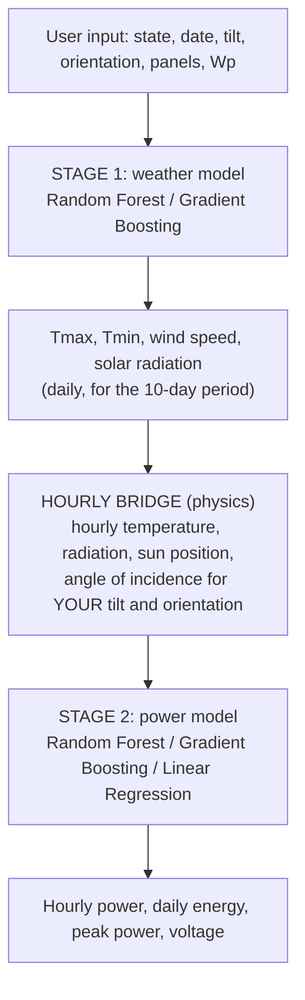

# ☀️ Solar Power Prediction for Indian States

**A two-stage classical machine learning pipeline** that predicts how much electricity solar panels will generate in any Indian state, on any date, for any panel tilt and orientation.

> Built with **Random Forest**, **Gradient Boosting** and **Linear Regression**, using **10 years of NASA POWER weather data** for 36 states and union territories.

🔗 **Live demo:** `I will update it once the project is deployed fully`

---

## 📌 Table of Contents

1. [What it does](#-what-it-does)
2. [How it works](#-how-it-works)
3. [Key concepts](#-key-concepts)
4. [Data](#-data)
5. [Results](#-results)
6. [Project structure](#-project-structure)
7. [Quick start](#-quick-start)
8. [Method in detail](#-method-in-detail)
9. [Limitations](#-limitations-read-this)
10. [Future work](#-future-work)
11. [Tech stack and sources](#-tech-stack-and-sources)

---

## 🎯 What it does

You enter:

| Input | Example |
|---|---|
| **State / Union Territory** | Rajasthan |
| **Date** | 17 October 2026 |
| **Panel tilt** | 25° |
| **Panel orientation** | 180° (south) |
| **Number of panels** | 20 |
| **Rating per panel (Wp)** | 400 |

You get:

- 🌡️ **Expected weather** for that 10-day period: **Tmax, Tmin, wind speed, solar radiation** (with the historical range)
- ⚡ **Hourly power curve** and **energy per day (kWh)**
- 📈 **Peak power (kW)**
- 🔌 **Panel voltage at peak (V)** (from physics, not ML)

---

## 🧠 How it works



**The output of Stage 1 is the input of Stage 2.** That is the chain.

### Stage 1: weather for a state and 10-day period
- Each month is split into three **dekads**: days **1–10**, **11–20**, **21–end**. That gives **36 periods per year**.
- Example: **17 October** falls in the **11–20 October** period (index 28).
- **Inputs:** latitude, longitude, period of the year, year, extraterrestrial radiation (`h0`).
- **Outputs:** `tmax`, `tmin`, `wind_speed`, `solar_radiation`.

### Hourly bridge: from daily to hourly
Stage 1 gives daily numbers, but Stage 2 learns from hourly rows. The bridge builds a realistic hourly day:
- **Temperature:** smooth curve between Tmin and Tmax, peaking at 15:00
- **Radiation:** spread over the daylight hours by sun height, adding up to the daily total
- **Wind:** constant at the daily mean
- **Angle of incidence:** calculated from the sun's position and **your** tilt and orientation

### Stage 2: weather and sun angle to power
- **Inputs:** `temp`, `wind`, `ghi` (radiation), `aoi` (angle of incidence), `cos_aoi`, `g_cos`
- **Target:** power as a **capacity factor**, which scales to any number of panels and any rating

---

## 🔑 Key concepts

| Concept | Meaning |
|---|---|
| **Dekad** | A 10-day period. Each month is split into days 1–10, 11–20 and 21–end |
| **Climatology baseline** | Average of the same state and period in past years. A model must beat it to be useful |
| **Angle of incidence (AOI)** | Angle between sunlight and the panel's normal. Output is proportional to cos(AOI) |
| **Tilt / Orientation** | Panel angle from flat / compass direction it faces (180° = south) |
| **GHI** | Global horizontal irradiance: sunlight on a flat surface |
| **Capacity factor** | Power divided by a reference output. Used to scale to any system size |
| **Time-based split** | Train on the past and test on the future. Random splits would leak information |
| **Hourly bridge** | Physics step that converts daily weather to an hourly day |

### Why these design choices?

- ✅ **Time-based splits only.** Stage 1 is split by **year** and Stage 2 by **row order** (first 80% train, last 20% test). Neighbouring days and hours are nearly identical, so random splits would give fake accuracy.
- ✅ **Stage 2 uses AOI, not zenith/azimuth.** For a fixed panel those two together reveal its geometry, and the model would ignore AOI. Using AOI lets the model respond when you change the tilt.
- ✅ **Voltage is physics.** No dataset contains voltage, and it is mostly set by panel design and temperature (about −0.3% per °C).
- ✅ **Stage 2 only uses what Stage 1 can supply.** Pressure, precipitation, cloud layers and other columns were dropped for this reason.

---

## 📊 Data

### Stage 1: NASA POWER (daily weather)
| Column | NASA parameter | Unit |
|---|---|---|
| `tmax` | `T2M_MAX` | °C |
| `tmin` | `T2M_MIN` | °C |
| `wind_speed` | `WS10M` | m/s |
| `solar_radiation` | `ALLSKY_SFC_SW_DWN` | kWh/m²/day |

- **36 states and union territories**, one representative point each
- **2016 to 2025** (about 3,653 days per state, about 130,000 rows)
- Missing values are marked `-999` by NASA and converted to blanks

### Stage 2: plant generation data
- Hourly rows with weather, sun angles and measured **`generated_power_kw`**
- Only **daytime rows** (zenith < 90°) are used
- A fit of the `angle_of_incidence` column on the sample rows matched a **fixed panel tilted about 45° facing south**, with an error of 0.07°. Re-run this check on the full file (`Appendix B` of the documentation) and write your own result here: `TILT = __, AZIMUTH = __, ERROR = __`

---

## 🏆 Results

> As the project has not been completed yet, so i will fill it with XX for now.

### Stage 1: mean absolute error on unseen years (2023–2025)

| Model | Tmax (°C) | Tmin (°C) | Wind (m/s) | Radiation (kWh/m²/day) |
|---|---|---|---|---|
| Climatology baseline | XX | XX | XX | XX |
| Random Forest | XX | XX | XX | XX |
| Gradient Boosting | XX | XX | XX | XX |

### Stage 2: test set (last 20% of rows)

| Model | R² | MAE (kW) | RMSE (kW) |
|---|---|---|---|
| Linear Regression | XX | XX | XX |
| Random Forest | XX | XX | XX |
| Gradient Boosting | XX | XX | XX |

### Full chain validation

| Test | Result |
|---|---|
| Stage 2 alone, real inputs | XX |
| Hourly bridge test (daily summary, then hourly rebuild) | XX |
| Chain vs PVGIS, 3 to 5 states | XX |

**Sanity checks the chain must pass:**
- ✔ A **south-facing** panel produces more than a **north-facing** one
- ✔ **Monsoon** months produce less than spring months in most states
- ✔ **Doubling the panels** doubles the energy

---

## 📁 Project structure

```
solar-power-prediction/
├── nasa_power_downloader.py   # downloads NASA data (automatic, resumable)
├── merge_nasa_csv.py          # merges all state/year files into one CSV
├── common.py                  # shared helpers: dekads, sun position, AOI, features
├── stage1_train.py            # trains Stage 1 (weather)
├── stage2_train.py            # trains Stage 2 (power)
├── chain.py                   # connects Stage 1 to Stage 2
├── app.py                     # Streamlit web app
├── requirements.txt
├── README.md
├── nasa_raw/                  # downloaded files (one folder per state)
├── nasa_power_india_daily.csv # merged weather data (created by merge)
└── plant_data.csv             # your plant dataset (put it here)
```

---

## 🚀 Quick start

### 1. Install

```bash
git clone https://github.com/YOUR-USERNAME/solar-power-prediction.git
cd solar-power-prediction
python -m venv venv
venv\Scripts\activate          # on Mac/Linux: source venv/bin/activate
pip install -r requirements.txt
```

### 2. Get the weather data

```bash
python nasa_power_downloader.py   # takes 30 to 60 minutes; safe to stop and re-run
python merge_nasa_csv.py          # creates nasa_power_india_daily.csv
```

> 💡 If you see **connection reset** errors, keep the script running (it retries by itself), switch network, or turn off VPN and antivirus web shields.

### 3. Add the plant data
Place your plant file in the project folder as `plant_data.csv`. It must contain `temperature_2_m_above_gnd`, `wind_speed_10_m_above_gnd`, `shortwave_radiation_backwards_sfc`, `angle_of_incidence`, `zenith` and `generated_power_kw`.

### 4. Train both stages

```bash
python stage1_train.py   # saves stage1 models, states.csv, history_ranges.csv
python stage2_train.py   # saves stage2_model.joblib
```

Read the printed metrics. They go into the Results tables above.

### 5. Run the app

```bash
streamlit run app.py
```

---

## 🔬 Method in detail

### Stage 1 workflow
1. Clean: convert `-999` to missing, interpolate gaps of up to 5 days per state
2. Convert daily data to **10-day means** (12,960 rows: 36 states × 10 years × 36 periods)
3. Add features: location, period (plain and sine/cosine), year, extraterrestrial radiation
4. **Split by year:** train 2016–2022, test 2023–2025
5. Train **Random Forest** (300 trees) and **Gradient Boosting** (300 trees, learning rate 0.05)
6. Compare with the **climatology baseline**
7. Store the historical **10th–90th percentile** range for display

### Stage 2 workflow
1. Keep daytime rows only, keep time order
2. Build features from temperature, wind, radiation and the angle of incidence
3. Target = power / reference output (99.5th percentile)
4. **Split:** first 80% train, last 20% test
5. Train **Linear Regression** (baseline), **Random Forest**, **Gradient Boosting**
6. Choose the best model by test R² and save it

### Chain calculation
For each hour of the chosen day: radiation, temperature and wind → angle of incidence for **your** tilt and orientation → Stage 2 → power. Daily energy is the sum of the 24 hourly values. Output is scaled by `panels × Wp / 1000` and a **calibration factor** (default 1.0).

### Calibration
The plant's true rating is unknown, so output can be about **10–20% too high**. Compare against **PVGIS** (free EU tool) for 3 to 5 states and set the calibration factor to the median ratio. Until then, treat results as **relative**.

---

## ⚠️ Limitations (read this)

- **Typical, not forecast.** Stage 1 predicts typical weather for a 10-day period, not tomorrow's weather. Use the shown range.
- **One point per state.** Large states (Rajasthan, Maharashtra, Jammu and Kashmir) vary internally.
- **Only 10 years of weather.** Tree models cannot extrapolate the long-term warming trend.
- **Plant data is probably from outside India** and has a single fixed tilt. Other tilts work only through the angle of incidence.
- **Two radiation sources** (NASA and the plant dataset) may differ. Check their distributions.
- **Voltage is a physics estimate**, not a learned prediction.
- **Scaling to any system size** depends on the calibration factor.

---

## 🔭 Future work

- District or multi-point predictions per state
- 50 years of data using reanalysis sources
- Humidity and cloud cover as extra inputs
- Several plants with different tilts
- Uncertainty intervals for power
- Tracking-panel option

---

## 🛠️ Tech stack and sources

**Python** · pandas · NumPy · scikit-learn · joblib · SciPy · Streamlit

**Data and references**
- [NASA POWER](https://power.larc.nasa.gov): daily weather and solar data
- [PVGIS](https://re.jrc.ec.europa.eu/pvg_tools/en/): photovoltaic performance tool (calibration)
- Duffie and Beckman, *Solar Engineering of Thermal Processes* (solar geometry equations)
- Breiman (2001), *Random Forests*; Friedman (2001), *Gradient Boosting Machine*

---

## 📄 License and author

MOHAMMED SAHIL SIDDIQUI, sahilsiddiqui1702@gmail.com
